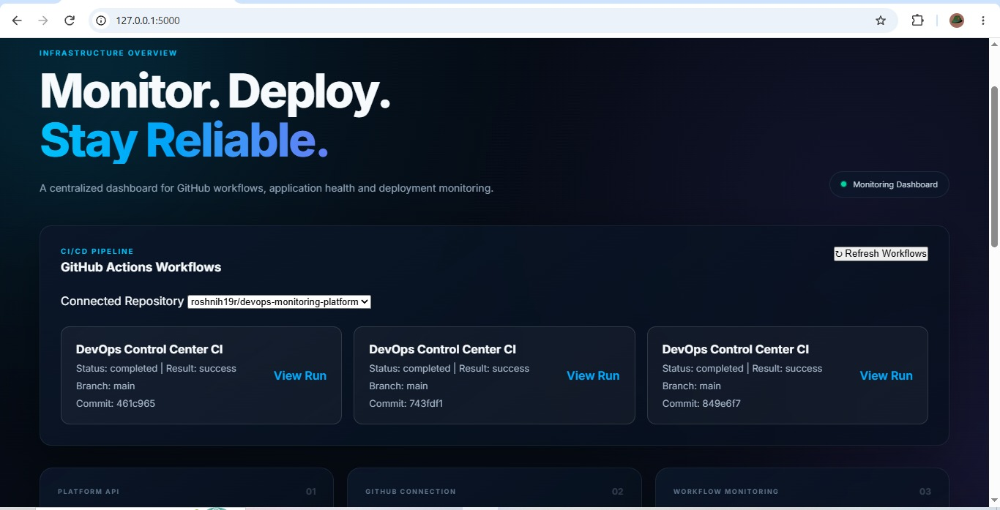
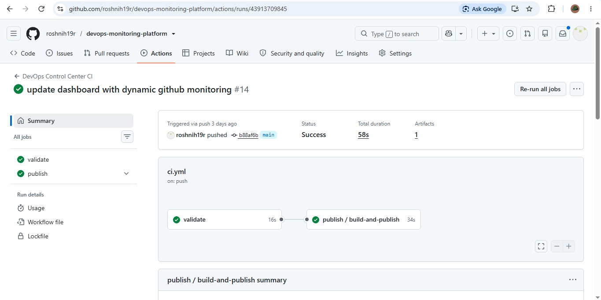
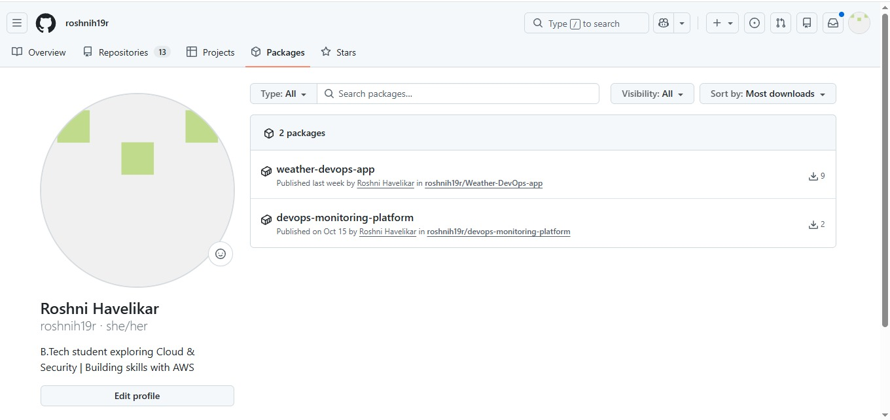

# DevOps Control Center

A Flask-based DevOps dashboard with reusable GitHub Actions workflows for CI automation, Docker image publishing, and AWS EC2 deployment.

## Overview

DevOps Control Center provides a centralized dashboard to view GitHub repositories, recent workflow runs, deployment history, and platform health.

The repository also contains reusable GitHub Actions workflows that other repositories can call to automate CI and deployment.

## Features

- **GitHub App integration:** Retrieve repositories authorized for the configured GitHub App installation.
- **Workflow monitoring:** View recent GitHub Actions workflow runs for selected repositories.
- **Reusable CI workflow:** Validate Python code, run Flask route checks, build Docker images, and publish images to GitHub Container Registry (GHCR).
- **Reusable deployment workflow:** Deploy Docker containers to AWS EC2 using GitHub Actions OIDC and AWS Systems Manager (SSM).
- **Deployment verification:** Check application health after deployment and restore the previous container if the new deployment fails.
- **Dashboard:** View platform health, workflow status, and deployment history.


## Project Screenshots

### Dashboard



### GitHub Actions CI Pipeline



### GitHub Container Registry



## Architecture

```text
Developer pushes code
        |
        v
GitHub Actions CI
        |
        v
Python syntax check and Flask route tests
        |
        v
Docker image build
        |
        v
Publish image to GHCR
        |
        v
Reusable deployment workflow
        |
        v
AWS authentication using OIDC
        |
        v
AWS Systems Manager (SSM)
        |
        v
EC2 pulls and runs Docker image
        |
        v
Health check and rollback on failure
```

## Technology Stack

- Python 3.12
- Flask
- Docker
- GitHub Actions
- GitHub App
- GitHub Container Registry (GHCR)
- Amazon EC2
- AWS Systems Manager (SSM)
- AWS IAM OIDC

## Project Structure

```text
devops-monitoring-platform/
├── .github/
│   └── workflows/
│       ├── ci.yml
│       ├── reusable-ci.yml
│       └── reusable-deploy.yml
├── app/
│   ├── app.py
│   ├── github_client.py
│   ├── templates/
│   │   └── index.html
│   └── static/
│       ├── script.js
│       └── style.css
├── Dockerfile
├── requirements.txt
└── README.md
```

## API Endpoints

| Method | Endpoint | Description |
|---|---|---|
| GET | `/` | Serves the dashboard |
| GET | `/health` | Returns platform health |
| GET | `/api/github/repositories` | Retrieves repositories available to the GitHub App installation |
| GET | `/api/github/workflows/<owner>/<repo>` | Retrieves recent workflow runs for an authorized repository |

The GitHub API endpoints require a correctly configured GitHub App. The application returns an error response if a GitHub API request fails.

## CI/CD Workflows

### 1. Main CI workflow

The `ci.yml` workflow runs on pushes and pull requests targeting the `main` branch. It:

1. Installs Python dependencies.
2. Checks Python syntax.
3. Runs Flask route smoke tests.
4. Builds the Docker image.
5. On pushes to `main`, calls the reusable CI workflow to publish the image.

### 2. Reusable CI workflow

The `reusable-ci.yml` workflow is triggered through `workflow_call`. It accepts the image name, Dockerfile path, and build context as inputs. It builds and publishes the image to GHCR using both the `latest` tag and the commit SHA tag.

### 3. Reusable deployment workflow

The `reusable-deploy.yml` workflow accepts deployment configuration such as the image name, AWS role, region, EC2 instance ID, container name, and container ports. It:

1. Authenticates to AWS using GitHub Actions OIDC.
2. Checks that the target EC2 instance is running.
3. Sends deployment commands through AWS Systems Manager (SSM).
4. Pulls the requested Docker image onto EC2.
5. Replaces the running container while preserving the previous one temporarily.
6. Checks the new container's health endpoint.
7. Removes the previous container after success, or restores it if the health check fails.

The GHCR image used for the tested deployment was public, so the EC2 host could pull it without private-registry credentials.

## Dashboard Health Information

The dashboard shows platform health and GitHub workflow information.

The displayed application health verification is based on the latest successful deployment workflow. It is **not** a continuous live health check of the deployed application.

AWS infrastructure metrics such as EC2 status, CloudWatch CPU utilization, and Docker container metrics are not currently connected to the dashboard.

## Run Locally

### Prerequisites

- Python 3.12
- Git

### Clone the repository

```bash
git clone https://github.com/roshnih19r/devops-monitoring-platform.git
cd devops-monitoring-platform
```

### Install dependencies

```bash
python -m pip install -r requirements.txt
```

### Configure GitHub App integration

Set the following environment variables for the GitHub App integration:

- `GITHUB_APP_ID`
- `GITHUB_INSTALLATION_ID`
- `GITHUB_PRIVATE_KEY_PATH`

Provide the GitHub App private key securely at the configured path. Do not commit private keys, tokens, or `.env` files to the repository.

### Start the application

```bash
python -m app.app
```

Open `http://localhost:5000` in your browser.

## Deployment Status

The dashboard and reusable deployment workflow were previously deployed and tested using AWS EC2. The reusable deployment workflow was also tested with another application.

AWS access is currently unavailable because the AWS account is suspended due to a billing issue, so the hosted application cannot currently be accessed.

## Current Limitations

- Live AWS infrastructure monitoring is not integrated.
- EC2 status, CloudWatch CPU metrics, and Docker container monitoring are pending.
- Dashboard application health is based on deployment workflow verification, not continuous live checks.
- Deployment requires a valid AWS account, correct IAM OIDC and SSM permissions, and a running EC2 instance.

## Future Improvements

- Integrate EC2 instance status monitoring.
- Add CloudWatch CPU utilization metrics.
- Add Docker container monitoring.
- Improve deployment visibility and monitoring.

## Author

**Roshni Havelikar**

GitHub: [roshnih19r](https://github.com/roshnih19r)
